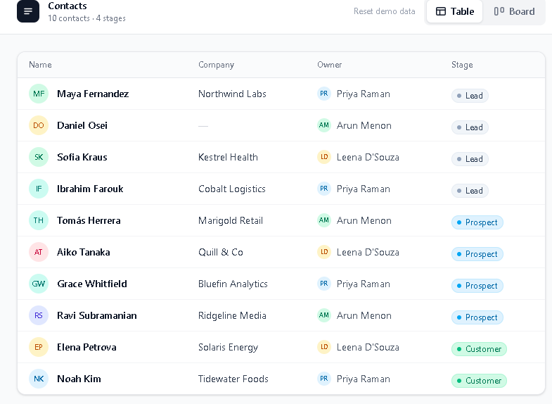
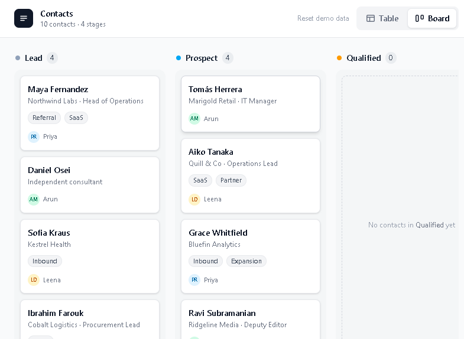

# Contacts — Table & Board

Take-home exercise: two working views (table + board) over one shared dataset of fictional contacts, with a shared details panel that edits Stage and Notes from either view.

## Preview

**Table** — responsive columns, single-line rows, missing data as an em dash:



**Board** — the same records grouped by stage, with an empty group by design:



## Run it

```bash
npm install
npm run dev      # http://localhost:5173
```

Other scripts: `npm run typecheck`, `npm run build` (typecheck + production build), `npm run preview`.

**Stack:** React 19 + TypeScript (strict), Vite, Tailwind CSS v4. No state library, no router, no backend — mock data and local state only, as requested.

## What to try

- **Table ⇄ Board** (top right). The switch is a proper tab list — arrow keys work.
- **Click any row or card** to open the details panel, edit **Stage** or **Notes**, then **Save changes** (commits and closes) or **Cancel** / **Escape** / backdrop click (discards).
- Move a contact between stages and switch views: the record appears in exactly one place with the new stage, no duplicates or stale copies.
- Close a panel — the view you were in is untouched, and keyboard focus returns to the row/card you came from.
- **Qualified** on the board is intentionally empty; several contacts are missing email/company/role/labels/notes on purpose.
- **Reset demo data** (header) restores the original dataset after you've edited it.

## Design decisions

**One source of truth.** `App` owns a single `contacts` array. The table and the board both derive from it; only *Save* writes to it. There is no sync layer to get wrong — a saved stage change lands in both views because they are two renderings of the same data.

**Edits are a draft that commits on Save.** Stage/Notes live in the panel's local state (the panel is keyed by record id, so opening a different record starts clean). Cancel, Escape, backdrop and unmount therefore can't leave a half-edited row, and switching views can never leak partial state — the panel is modal, so there is no path where a draft and the shared array disagree.

**View is UI state, not navigation.** `view` is untouched by opening/closing a record, which is what "preserve the user's view" requires, and keeps the switch cheap: it's a re-render, not a reload.

**Field placement** (the brief asked for these decisions):

| Surface | Fields |
| --- | --- |
| Table | Name, Email, Company, Role, Owner, Labels, Stage — Notes is left out: it's prose, wrong for a scanning surface |
| Card | Name, Company · Role, up to 2 labels + overflow, owner; a **No email** flag when identity data is missing |
| Panel | All 8 fields; **Stage** and **Notes** are the editable ones (exactly what the brief requires), the rest is context |

**Visual language.** Quiet Notion-like neutrals with one accent colour per stage, so the board reads at a glance and the table stays scannable. Dense single-line rows (~13–14px type) in the table, airier cards on the board.

**Missing data is a state, not an error.** Em dash with screen-reader text ("No email"); no filler values, no collapsed cells.

**Responsive.** Rather than scrolling at every width, columns drop out at breakpoints chosen so the rest still fits: all seven at ≥1280; Role and Labels below that (≥1024: Name, Email, Company, Owner, Stage); Email below 1024 (≥768: Name, Company, Owner, Stage); Owner below 768. Name, Company and Stage always stay — horizontal scroll is only the last-resort fallback on phone widths. Board columns keep a minimum width and scroll horizontally on narrow screens, growing to fill on wide ones.

## Accessibility & robustness

- View switch: `role="tablist"`, roving tabindex, arrow/Home/End keys, panels wired with `aria-controls`/`aria-labelledby`.
- Panel: `role="dialog"` + `aria-modal`, labelled by the record name, focus moves in on open, **Tab is trapped**, Escape cancels, page scroll is locked while open.
- **Focus return after close** re-queries the row/card by id instead of holding the old element: saving a stage change re-parents a board card into another column (React mounts a new node), so a stale reference would silently drop focus.
- Saves are announced through a polite `aria-live` region ("Saved. Maya Fernandez moved to Customer.").
- Real table semantics (`<th scope="col">`, sr-only caption), `role="status"` for unsaved-changes state, one global `:focus-visible` ring so keyboard position is always visible.

## Trade-offs

- **Modal panel instead of a non-modal side panel** — stronger focus containment and a simpler keyboard story; the cost is that you can't interact with the table while a record is open.
- **Stage + Notes only are editable.** The brief only requires those two; making identity fields editable would have spread validation across both views for little evaluation value.
- **Native `<select>` for stage** — less stylable than a custom listbox, but bulletproof keyboard and screen-reader behaviour.
- **No persistence:** refresh resets the demo (keeps the exercise honest — no fake backend).
- **No drag & drop** (explicitly optional); the stage select + save flow is the canonical path and works everywhere, including by keyboard.

## Left unfinished (and what I'd do next)

1. Drag & drop between columns *plus* a keyboard equivalent (move to stage menu), since DnD alone is inaccessible.
2. Search, owner/label filters, column visibility and a persisted view preference (`localStorage`), all derived from the same array.
3. Inline stage editing from the card/table without opening the panel, keeping the same draft-commit model.
4. Mobile layout: bottom-sheet panel instead of a right drawer.
5. Playwright coverage for the save/cancel/focus flows and an axe check in CI; virtualised rows for 1k+ records.

## Structure

```
src/
  App.tsx                  # single contacts array, view state, open/save/close + focus return
  types.ts                 # Contact, Stage, ViewMode, ContactDraft
  data/contacts.ts         # 10 fictional contacts (incl. empty-group + missing-data cases)
  lib/stages.ts            # stage order + colour metadata
  lib/format.ts            # initials, deterministic avatar colours
  components/
    ViewSwitch.tsx         # Table/Board tab list (keyboard: arrows, Home, End)
    TableView.tsx          # responsive table; whole row opens details
    BoardView.tsx          # 4 stage columns derived from the same array; empty state
    DetailsPanel.tsx       # dialog with draft Stage/Notes, save/cancel, focus trap
    StageBadge.tsx, Avatar.tsx, LabelList.tsx, Missing.tsx
```
